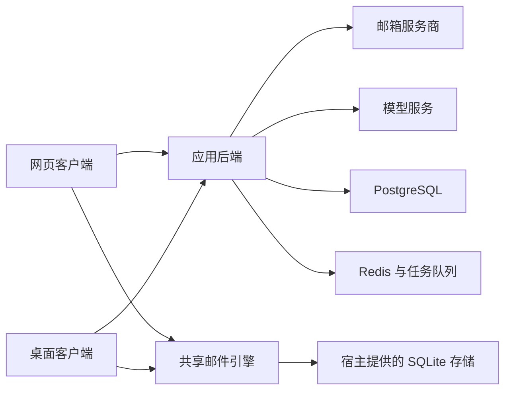

## 1. 仓库组织

项目使用 pnpm 工作区和 Turborepo 管理多个应用与共享包。当前包含 6 个应用、15 个共享或工具包。

| 目录 | 职责 |
| --- | --- |
| `apps/web` | 网页界面、后端接口、身份验证、邮件服务商适配、AI 业务、数据库模型和测试 |
| `apps/desktop` | Electron 宿主、桌面窗口、通知、更新及本地邮件界面 |
| `apps/worker` | 基于 BullMQ 的后台任务消费进程 |
| `apps/unsubscribe-worker` | 可选的浏览器退订执行服务 |
| `apps/image-proxy` | Cloudflare 图片代理入口 |
| `apps/image-proxy-aws` | AWS Lambda 图片代理入口 |
| `packages` | 可复用的邮件、网络、调度、邮件模板、统计和命令行模块 |
| `docker`、`charts`、`copilot` | 容器、Kubernetes 和 AWS 部署资源 |

## 2. 主要数据流

图中表示模块职责。浏览器与桌面端采用各自的运行时适配器；后端任务是否独立运行取决于所选队列和部署方式。

## 3. 共享包

| 共享包 | 用途 |
| --- | --- |
| `mail-core` | 邮箱状态、查询语义、操作状态及引擎接口 |
| `mail-sqlite` | 邮件数据库结构、查询和事务存储 |
| `mail-react` | 将引擎状态连接到 React |
| `mail-ui` | 网页端和桌面端共用的邮件界面 |
| `email-editor` | 邮件 HTML 合同与编辑器 |
| `network`、`image-proxy` | 网络访问约束和邮件图片代理 |
| `scheduling` | 可用时间等调度逻辑 |
| `transactional-email`、`loops` | 事务通知和营销邮件配套 |
| `tinybird`、`tinybird-ai-analytics` | 邮件及 AI 活动统计 |
| `api`、`cli` | 公共 API 操作和部署命令行工具 |
| `tsconfig` | 共享 TypeScript 配置 |

## 4. 数据存储职责

PostgreSQL 保存应用账户、规则、业务记录及邮件整理的模拟邮箱。Redis 提供缓存、订阅和所选后台任务所需能力。SQLite 保存客户端邮件状态，支撑查询和操作队列；它不能替代应用的 PostgreSQL。

本地启动器的数据位于 `.context/local-dev/`，便携程序位于 `.context/native/`。测试模拟器与真实邮箱服务商采用不同的运行边界。

## 5. 设计资料的适用范围

本页说明当前模块职责。[共享邮件引擎](/zh-CN/mail-engine)进一步说明合同与一致性要求。原有 `docs/plans/` 中的方案包含历史设计和被替换的内容，阅读时应结合当前源码确认，不能直接当作全部已实现的功能清单。
